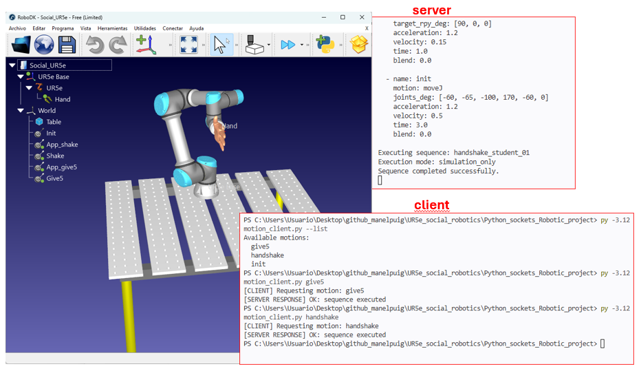
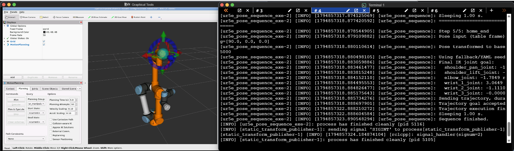

# Social Robotics with the UR5e

## Project introduction

This project is about designing a social movement for a UR5e collaborative robot arm and learning how software sends that movement to a robot. Examples are waving, giving five, pointing, and offering a handshake.

The goal is not only to make the arm move. The movement must have a clear meaning, work in simulation, and be checked for safety.

### What will we learn?

- How to describe a robot movement as a sequence of steps.
- How to use YAML files to store movement data.
- How software can request a robot behaviour.
- How to test a movement in simulation before using a real robot.
- How Python sockets and ROS 2 solve similar communication problems.

## Two ways to build the project

| Project stage | Student request | Simulation and execution |
| --- | --- | --- |
| Python sockets | The client sends the complete YAML sequence to a TCP server. | RoboDK, then the real UR5e only with approval. |
| ROS 2 | The student publishes a behaviour name. The server loads the matching YAML file. | Fake UR5e with MoveIt 2, then the real UR5e only with approval. |

The ROS 2 handshake example has five steps: init pose, approach handshake pose, handshake pose, approach handshake pose, and return to init pose. 

It moves to a fixed pose; it does not detect or follow a person's hand.

## Laboratory architecture

The laboratory has four student PCs acting as clients and one teacher PC acting as the server. Only the teacher PC is connected to the UR5e.

```text
Student PC 1 (client) --+
Student PC 2 (client) --+
Student PC 3 (client) --+ --> Teacher PC (server) --> UR5e
Student PC 4 (client) --+         |                    real hardware
                                  v
                           RoboDK or MoveIt 2 / RViz
```

In the classroom, the teacher PC receives the request, validates and runs the approved motion. Students never connect directly to the physical UR5e. For the **previous activities below**, this architecture is simplified: the client and server run on the same student PC so that each student can test safely in simulation before the laboratory session.

## From an idea to a tested movement

1. Choose what the movement means to a person.
2. Choose safe starting, middle, and ending poses.
3. Create a YAML sequence for each architecture.
4. Test the complete sequence in simulation.
5. Check the motion and fix problems.
6. Ask the teacher to review it before any real-robot test.

## What will you submit?

1. A Python sockets YAML file.
2. A ROS 2 YAML file.
3. A short description of the social meaning and chosen poses.
4. Evidence that both versions worked in simulation.
5. Evidence of a supervised real-robot test, **if the teacher approves one**.
6. A short comparison of the two architectures.

In the comparison, explain what the student sends in each version, where the server finds the YAML file, how access to the real robot is managed, how success or errors are reported, and what ROS 2 provides compared with the custom TCP protocol.

## Safety comes first

- Test every movement in simulation first.
- Keep the work area clear and use slow, smooth movements.
- Check the start, middle, and end poses.
- Never run an unapproved movement on the real UR5e.
- A real-robot test needs teacher approval and supervision.

The ROS 2 pose sequence uses inverse kinematics to find joint targets. A successful IK result does not by itself prove that the full path is collision-free.

# Guided practical activity: previous simulation before each session

Complete the corresponding activity **before** the classroom session. Fork the repository first, use your personal clone, and run the client and server on **one computer only**. These are simulation exercises: do not connect to a real UR5e.

In both sessions, first verify the supplied `handshake` and `give5` motions. Then recover the social motion that you designed in the first laboratory session of the course and translate it into a new YAML file in the relevant `motions/` folder, following the supplied examples. Finally, verify your own motion in simulation.

In the laboratory, the same order is used: first simulate the approved motion with the student PC as client and the teacher PC as server; only after that simulation succeeds may the teacher supervise a real-UR5e test.

For these sessions, motions are requested only through the command parameter (Python sockets) or the ROS 2 topic. Voice and face control are outside the activity scope and may be shown only as a later demonstration.

## Common step - fork and clone your personal copy

1. Open the [project repository on GitHub](https://github.com/manelpuig/UR5e_social_robotics), sign in, and select **Fork**.
2. Replace `GITHUB_USERNAME` below with your GitHub username.

## Session 1 - Windows, VS Code, Python sockets and RoboDK

### Goal and requirements

Before Session 1, simulate `handshake` locally. The Python TCP server and client run in separate VS Code PowerShell terminals on the same Windows computer. RoboDK is the simulator.

You need Windows, VS Code, Git, the Python launcher with **Python 3.10**, RoboDK, and a GitHub account. The classroom PCs already have the remaining software; install only PyYAML on your own PC.

### 1. Clone and open the project

In PowerShell (VS Code integrated terminal or Windows Terminal), run:

```powershell
cd $HOME
git clone https://github.com/GITHUB_USERNAME/UR5e_social_robotics.git
cd UR5e_social_robotics
```

### 2. Install PyYAML

In the VS Code terminal:

```powershell
py -3.11 -m pip install PyYAML
```

No virtual environment, voice-control setup, or face-control setup is needed for these sessions.

### 3. Configure one-computer simulation

Open `Python_sockets_Robotic_project/config.py` and set:

```python
SERVER_IP = "127.0.0.1"
EXECUTION_MODE = "simulation_only"
```

`127.0.0.1` is the same computer. `simulation_only` prevents any real-robot connection.

### 4. Verify the examples and create your motion

Open two VS Code PowerShell terminals and change to the project folder in both:

```powershell
cd $HOME\UR5e_social_robotics\Python_sockets_Robotic_project
```

**Terminal 1 - server**

```powershell
py -3.11 ur5e_motion_server.py
```

RoboDK should open and the terminal should report that it is listening on port `5000`. Keep it running.

**Terminal 2 - client**

```powershell
py -3.11 motion_client.py --list
py -3.11 motion_client.py handshake
py -3.11 motion_client.py give5
```

The server must receive each YAML, RoboDK must show each complete motion, and the client must print `OK: sequence executed`.

 

Next, create `motions/<motion_name>.yaml` from `motions/handshake.yaml` or `motions/give5.yaml`. It must represent the social motion you designed in the first laboratory session. Register the same lowercase name in `MOTIONS` in `behavior_manager_client.py`, for example:

```python
MOTIONS = {
    "handshake": "motions/handshake.yaml",
    "give5": "motions/give5.yaml",
    "wave": "motions/wave.yaml",
}
```

Then simulate your own motion:

```powershell
py -3.11 motion_client.py wave
```

Replace `wave` with your own name. Stop the server with `Ctrl+C` when finished.


## Session 2 - Ubuntu 22.04, VS Code and ROS 2 Humble

### Goal and requirements

Before Session 2, simulate the same `handshake` movement locally with ROS 2, the fake UR5e driver, MoveIt 2, and RViz. All five ROS 2 processes run on the same Ubuntu computer.

You need Ubuntu 22.04, VS Code, Git, and **ROS 2 Humble**. Work in TheConstruct environment for this activity. Each time you enter its environment, run:

```bash
sudo apt update
sudo apt install ros-humble-ur
```

### 1. Clone and open the project

In a terminal, run:

```bash
cd ~
git clone https://github.com/GITHUB_USERNAME/UR5e_social_robotics.git
cd ~/UR5e_social_robotics
```

### 2. Review `~/.bashrc`

Open it with `code ~/.bashrc` and add these lines at the end. Do not add duplicates if they already exist:

```bash
# ROS 2 Humble and this local workspace
source /opt/ros/humble/setup.bash
source "$HOME/UR5e_social_robotics/install/setup.bash"

# Local, one-computer simulation
export ROS_DOMAIN_ID=0
export ROS_LOCALHOST_ONLY=0
export RMW_IMPLEMENTATION=rmw_cyclonedds_cpp
```

For this local activity, `ROS_LOCALHOST_ONLY=0` enables ROS 2 communication on this computer and others in the network. 

### 3. Build the workspace

In the VS Code integrated terminal:

```bash
cd ~/UR5e_social_robotics
source /opt/ros/humble/setup.bash
colcon build
source install/setup.bash
```

If the build fails, save the error and ask the teacher to check the Ubuntu/ROS 2 installation before continuing.

### 4. Verify the examples and create your motion

Open **five VS Code terminals**. In each, run `source ~/.bashrc` (or open a new terminal after editing `.bashrc`). Then start one process in each terminal.

**Terminal 1 - fake UR5e driver**

```bash
ros2 launch ur_robot_driver ur_control.launch.py \
  ur_type:=ur5e robot_ip:=192.168.0.20 \
  use_fake_hardware:=true launch_rviz:=false
```

**Terminal 2 - MoveIt 2 and RViz**

```bash
ros2 launch ur_moveit_config ur_moveit.launch.py \
  ur_type:=ur5e launch_rviz:=true
```

Wait until RViz displays the robot and MoveIt 2 is ready.

**Terminal 3 - sequence server**

```bash
ros2 run ur5e_motion_server ur5e_sequence_server
```

**Terminal 4 - behaviour manager client**

```bash
ros2 launch social_robot_behaviors social_behavior.launch.py
```

**Terminal 5 - example requests**

```bash
ros2 topic pub --once /social_behavior std_msgs/msg/String \
  "{data: 'handshake'}"
ros2 topic pub --once /social_behavior std_msgs/msg/String \
  "{data: 'give5'}"
```

 

Both supplied motions must run in RViz. Next, create `src/social_robot_behaviors/motions/<motion_name>.yaml` by copying the structure of `handshake.yaml` or `give5.yaml` and translating the social motion from the first laboratory session. For example:

```bash
cd ~/UR5e_social_robotics/src/social_robot_behaviors/motions
cp handshake.yaml wave.yaml
```
Now modify the yaml file with the desired poses to describe the social movement, and compile again:

```bash
cd ~/UR5e_social_robotics
colcon build
source install/setup.bash
```

No Python registration is needed for ROS 2: the requested behaviour name must match the YAML filename without `.yaml`. In Terminal 5, send your motion:

```bash
ros2 topic pub --once /social_behavior std_msgs/msg/String \
  "{data: 'wave'}"
```

Replace `wave` with your own name.

### What should happen?

The fake UR5e should run `handshake`, `give5`, and your own social motion in RViz. Check terminal messages and verify that your motion starts, moves, and ends safely. `use_fake_hardware:=true` is essential: no physical UR5e is used.

If a node cannot find the others, run `source ~/.bashrc` in that terminal and check that all five terminals have the same values for `ROS_DOMAIN_ID`, `ROS_LOCALHOST_ONLY`, and `RMW_IMPLEMENTATION`. Stop all nodes with `Ctrl+C` when finished.

## Advantages of ROS2 versus python-sockets

- **Automatic discovery:** ROS 2 can find clients and servers on the network automatically. Python sockets require manually setting IP addresses and ports.

- **Standard communication:** ROS 2 uses standard topics and services. Python sockets need a custom TCP protocol.

- **Clear separation of responsibilities:** the client sends only the behaviour name, while the server loads and executes the corresponding YAML motion.

- **Easy distributed architecture:** ROS 2 is designed to run nodes on different computers, such as student clients and a teacher server.

- **Better debugging:** standard commands such as ros2 node list, ros2 topic list, and ros2 service list help inspect the system.

- **Integration with robot tools:** ROS 2 works directly with the UR driver, MoveIt 2, and RViz.

- **Scalability:** new clients, behaviours, sensors, or interfaces can be added without redesigning the communication protocol.

- **Simulation before hardware:** the same ROS 2 architecture can be tested with fake hardware and then used with the real UR5e under teacher supervision.

## More information

- [Classroom architecture](2_UR5e_Classroom_Architecture.md)
- [Python sockets architecture](3_Python_Sockets_Architecture.md)
- [ROS 2 architecture](4_ROS2_Architecture.md)
- [Project responsibilities and deliverables](5_SocialRobotics_Project.md)
- [UR5e setup and Python environment](1_UR5e_setup.md)
- [ROS 2 practical guide](../src/1_Instructions_ros2_SocialRobotics_Project.md)
- [Python sockets practical guide](../Python_sockets_Robotic_project/1_Instructions_python_SocialRobotics_Project.md)
