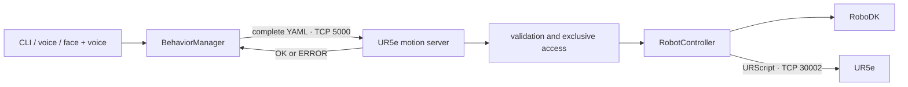
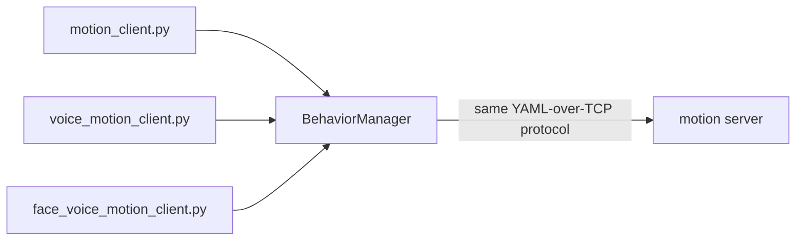

# Python sockets architecture

This document explains the architecture used in the first project session. For installation and execution commands, follow the [Python sockets execution guide](../Python_sockets_Robotic_project/1_Instructions_python_SocialRobotics_Project.md).

## Learning objectives

Students should be able to:

1. identify the client, server and robot controller;
2. explain what is sent through each TCP connection;
3. understand how a YAML sequence becomes robot movements;
4. describe why robot access is centralised on the Teacher PC;
5. identify the limitations of a custom socket protocol.

## Architecture overview



The Student PC never connects directly to the UR5e. It sends a complete YAML motion to the Teacher PC. The Teacher PC validates the request and is the only computer allowed to control the robot.

## Main files and responsibilities

| File | Responsibility |
|---|---|
| `motion_client.py` | Command-line interface used to select a behavior |
| `behavior_manager_client.py` | Resolves the behavior name, reads the YAML and communicates with the server |
| `ur5e_motion_server.py` | Receives and validates YAML, prevents concurrent executions and returns a result |
| `ur5e_robot_controller.py` | Executes the sequence in RoboDK, on the UR5e, or both |
| `config.py` | Network, robot, execution-mode and optional HRI configuration |
| `motions/*.yaml` | Declarative motion sequences |
| `command_interpreter.py` | Maps spoken phrases to registered behavior names |

Only the client and server scripts are entry points. `ur5e_robot_controller.py` is imported by the server and must not be started separately.

## The two TCP connections

```text
Student PC                       Teacher PC                         UR5e

BehaviorManager  -- YAML ------> motion server
                  TCP 5000             |
                                       v
                                 RobotController -- URScript ----> robot
                                                  TCP 30002
```

- **Port 5000:** application protocol between Student PC and Teacher PC. The request is the complete YAML text and the response is `OK` or `ERROR`.
- **Port 30002:** connection from the Teacher PC to the UR5e. It carries generated URScript instructions.

## Motion representation

A YAML sequence contains ordered steps. The project supports two movement types.

### `moveJ`: joint movement

```yaml
- name: initial_pose
  motion: moveJ
  joints_deg: [0, -90, 90, -90, -90, 0]
  acceleration: 0.5
  velocity: 0.1
```

`RobotController` converts the six joint values from degrees to radians and generates a URScript `movej(...)` instruction. RoboDK uses the same target for its `MoveJ()` simulation.

### `moveL`: linear Cartesian movement

```yaml
- name: greeting_pose
  motion: moveL
  target_xyz_mm: [-300, -300, 300]
  target_rpy_deg: [90, 0, 0]
  acceleration: 0.5
  velocity: 0.1
```

`RobotController` converts millimetres to metres and the RPY orientation to the rotation-vector format used by URScript. It then generates a `movel(...)` instruction or calls RoboDK `MoveL()`.

### Generated URScript syntax

For a joint movement, the controller generates:

```urscript
movej(q, a, v, t, r)
```

- `q`: six target joint positions in radians;
- `a`: joint acceleration;
- `v`: joint velocity;
- `t`: optional movement time in seconds;
- `r`: blend radius.

For example, the `moveJ` step above produces approximately:

```urscript
movej([0.000000,-1.570796,1.570796,-1.570796,-1.570796,0.000000],
      a=0.5, v=0.1, r=0.0)
```

For a linear Cartesian movement, the controller generates:

```urscript
movel(p[x, y, z, rx, ry, rz], a, v, t, r)
```

- `x`, `y`, `z`: tool position in metres;
- `rx`, `ry`, `rz`: rotation vector in radians;
- `a`: tool acceleration in `m/s²`;
- `v`: tool velocity in `m/s`;
- `t` and `r`: movement time and blend radius.

For example, the `moveL` step above produces approximately:

```urscript
movel(p[-0.300000,-0.300000,0.300000,1.570796,0.000000,0.000000],
      a=0.5, v=0.1, r=0.0)
```

When the YAML contains a positive `time`, the generated instruction includes `t=<seconds>`. The UR controller then uses that duration and ignores the acceleration and velocity values for the movement.

The steps are executed in order. A motion should always use safe initial, intermediate and final poses.

## Request lifecycle

```text
behavior name
    -> BehaviorManager finds the registered YAML
    -> client validates and sends the complete YAML
    -> server parses and validates the request
    -> server rejects the request if the robot is busy
    -> RobotController executes every step
    -> server returns OK or ERROR
```

The behavior name is local to the Student PC. The Teacher PC receives the YAML content, not just its filename.

## Alternative user interfaces



The CLI, voice and face-and-voice interfaces share the same communication layer. Face verification only acts as an access gate; it is not a robot safety system or secure biometric authentication.

## Why centralise robot access?

The Teacher PC provides one supervised access point. It validates requests, rejects simultaneous executions and keeps robot-specific configuration away from Student PCs.

## Limitations and transition to ROS 2

- IP address and port are configured manually;
- the YAML protocol is not a formally typed network interface;
- discovery, inspection and logging are application-specific;
- the client receives only a final response;
- an active request cannot be cancelled through this protocol;
- the socket layer does not provide kinematics or motion planning.

ROS 2 preserves the separation between command interface and robot execution while adding node discovery, typed interfaces and standard inspection tools.

## Next step

To create, simulate and execute a motion, follow the [Python sockets execution guide](../Python_sockets_Robotic_project/1_Instructions_python_SocialRobotics_Project.md).
