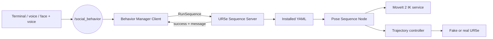

# ROS 2 architecture

This document explains the architecture used in the second project session. For installation and execution commands, follow the [ROS 2 execution guide](../src/1_Instructions_ros2_SocialRobotics_Project.md).

## Learning objectives

Students should be able to:

1. identify the ROS 2 nodes, topics, services and actions;
2. follow a behavior request from the Student PC to the robot;
3. explain the responsibilities of the Behavior Manager and sequence server;
4. understand where motion YAML files are stored and executed;
5. compare this architecture with the Python sockets solution.

## From Python sockets to ROS 2

| Element | Python sockets | ROS 2 |
|---|---|---|
| Manual input | `motion_client.py` | Message on `/social_behavior` |
| Communication | Custom TCP protocol | ROS 2 topic and typed service |
| Request sent | Complete YAML text | Behavior name |
| Motion file | Sent by the client | Installed on the Teacher PC |
| Robot interface | RoboDK / URScript | IK service and ROS 2 controller |
| Result | Text `OK` or `ERROR` | `success` and `message` fields |

## Architecture overview



The Student PC sends only the behavior name. The Teacher PC contains the approved YAML, calculates the joint targets and controls the fake or real robot.

## Packages and main files

| Package or file | Responsibility |
|---|---|
| `social_robot_behaviors` | Receives high-level behavior requests |
| `behavior_manager_client_node.py` | Converts `/social_behavior` messages into service requests |
| `ur5e_interfaces/srv/RunSequence.srv` | Defines the typed request and response |
| `ur5e_motion_server` | Validates names and serialises sequence execution |
| `ur5e_sequence_server.py` | Provides `/ur5e/run_sequence` and locates the YAML |
| `social_robot_behaviors/motions/*.yaml` | Installed social motion definitions |
| `ur5e_pose_sequence.py` | Calculates IK and sends joint trajectories |
| `social_robot_hri` | Optional voice, face and gesture input nodes |

## ROS 2 communication elements

| Type | Name | Interface | Purpose |
|---|---|---|---|
| Topic | `/social_behavior` | `std_msgs/msg/String` | Requested behavior name |
| Service | `/ur5e/run_sequence` | `ur5e_interfaces/srv/RunSequence` | Starts a named sequence |
| Topic | `/joint_states` | `sensor_msgs/msg/JointState` | Current robot joint state |
| Service | `/compute_ik` | `moveit_msgs/srv/GetPositionIK` | Converts a Cartesian pose into joint values |
| Action | `/scaled_joint_trajectory_controller/follow_joint_trajectory` | `control_msgs/action/FollowJointTrajectory` | Executes each joint target |

The custom service is:

```text
string sequence_name
---
bool success
string message
```

## Main node responsibilities

### Behavior Manager Client

`behavior_manager_client_node` subscribes to `/social_behavior`, validates the name, calls `/ur5e/run_sequence` and reports the result. This allows terminal, voice or other interfaces to use the same execution layer.

### UR5e Sequence Server

`ur5e_sequence_server` rejects invalid, missing or concurrent requests; resolves the name to an installed YAML; launches its execution; and returns a typed response.

The server normally reads YAML files from:

```text
~/UR5e_social_robotics/install/social_robot_behaviors/share/social_robot_behaviors/motions/
```

### Pose Sequence Node

For each YAML step, `ur5e_pose_sequence`:

1. transforms the Cartesian pose to the planning frame;
2. requests an inverse-kinematics solution from `/compute_ik`;
3. sends the joint target to `FollowJointTrajectory`;
4. waits for completion before processing the next step.

The current implementation uses MoveIt 2 for inverse kinematics. It does not use the complete MoveIt motion-planning pipeline, so a successful IK result does not guarantee a collision-free trajectory.

## Complete request lifecycle

```text
behavior name
    -> /social_behavior
    -> behavior_manager_client_node
    -> RunSequence(sequence_name)
    -> ur5e_sequence_server finds <sequence_name>.yaml
    -> ur5e_pose_sequence processes every step
    -> /compute_ik calculates each joint target
    -> FollowJointTrajectory controls the robot
    -> success or error response
```

## Fake hardware and real robot

The ROS 2 interfaces are the same in both cases:

- with **fake hardware**, the UR driver simulates the joint controllers;
- with the **real UR5e**, the Teacher PC connects to the robot and the External Control program must be active.

This allows the communication chain to be tested before physical execution.

## Optional HRI input

Voice and face verification replace only the first input layer:

```text
microphone -> voice_node -> /voice/text -> voice_interpreter_node
                                             |
                                             v
                                    /social_behavior
```

With face verification, interpreted requests first go to `/social_behavior/request`. The face node forwards authorised requests to `/social_behavior`. The remaining architecture is unchanged.

## Current limitations

- `RunSequence` provides no continuous progress or cancellation;
- each step sends one joint target rather than a fully planned MoveIt trajectory;
- YAML fields must match what `ur5e_pose_sequence.py` actually reads;
- face and voice interfaces are not safety systems.

A future version could use a ROS 2 action and the complete MoveIt planning pipeline.

## Next step

To configure the computers, create a YAML and execute the project, follow the [ROS 2 execution guide](../src/1_Instructions_ros2_SocialRobotics_Project.md).
