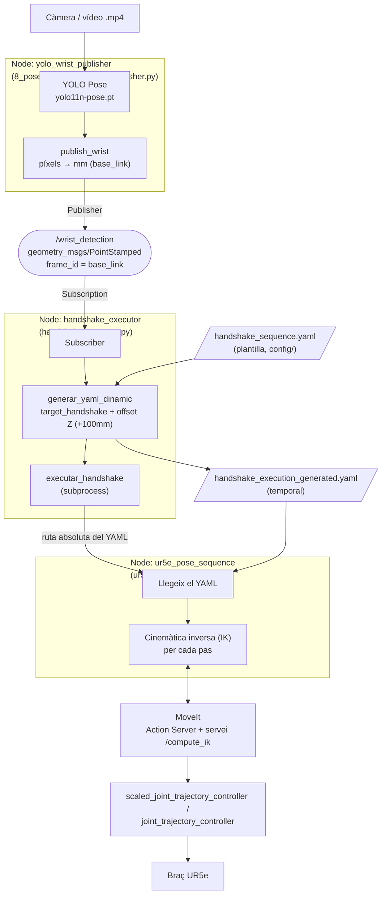

# PROJECTE: Moviment social interactiu

EL que volem aconseguir es que el robot localitzi la posició de la ma de la persona, i quan vegi on es troba vagi a aquell punt a fer el 'handshake'.

---

## Estructura basica

Tenim els següents fitxers:

### `handshake_executor.py`

Python script. Aquest script implementa un node ROS2 que agafa les coordenades tridimensionals rebudes de la detecció del canell per càmera, i les transforma en una seqüència de punts de moviment pel robot.

#### Generació Dinàmica del Fitxer de Configuració (`generar_yaml_dinamic`)

- **Llegida de la plantilla base:** Accedeix al fitxer `handshake_sequence.yaml` ubicat a la carpeta `config/`.
- **Càlcul de punts de seguretat:** Rep la posició de la mà (`target_handshake`) i calcula automàticament un punt d'aproximació (`target_approach`) afegint un desplaçament vertical (offset) en l'eix Z (per defecte +100mm). Així s'assegura que el robot s'apropi des de dalt abans de fer el contacte.
- **Transformació i correcció de coordenades:** Podem afegir un ajust lineal (`offset_taula`) per compensar desplaçaments entre el sistema de referència de la taula/càmera i la base del robot (`base_link`).
- **Exportació del YAML temporal:** Rescriu els passos `approach_handshake`, `handshake` i `retreat_handshake` amb les noves coordenades i guarda el resultat al fitxer temporal `handshake_execution_generated.yaml`.

#### Execució de la Trajectòria (`executar_handshake`)

- Utilitza la llibreria `subprocess` per iniciat el controlador de seqüències (`ur5e_pose_sequence.py`).
- Genera com a parametres la ruta absoluta del fitxer YAML, i així evita problemes de localització de paquets a la carpeta `install/` i permet que s'executi directament

#### Punt d'Entrada i Simulació de Dades (`main`)

- Inicialitza el node de ROS 2 (`rclpy.init()`).
- Defineix una posició simulada del canell (`posicio_canell_detectada`) per a proves d'integració (mock data), la qual serà substituïda més endavant per la detectada per la camera a través d'un subscriber (connectat al tòpic de la càmera).

---

### `handshake_sequence.yaml`

Aquest fitxer és la plantilla de la seqüència de moviments del robot. Defineix els paràmetres globals de planificació de MoveIt i la seqüència, pas a pas, que ha de seguir el braç robòtic UR5e.

#### Secció de Paràmetres Generals (`common`)

- `group_name: ur_manipulator`: Defineix el grup de planificació de MoveIt que controla les 6 articulacions del braç UR5e.
- `ik_link: tool0`: Indica quin punt de l'efector final que seria la eina del braç robotic s'ha de posicionar a les coordenades objectiu.
- `target_frame` / `planning_frame: base_link`: Determina el sistema de referència cartesià (X,Y,Z) respecte a la base del robot.
- `max_velocity` / `max_acceleration: 0.1`: Limita la velocitat i acceleració al 10% per motius de seguretat en la interacció humana.

#### Secció de Passos (`steps`)

Defineix un flux de 5 fases consecutives per realitzar l'acció de donar la mà:

1. `home_start`: Posició inicial de repòs segura (definida per coordenades i angles en `seed_joints`).
2. `approach_handshake`: Posició d'aproximació per sobre de la mà de la persona.
3. `handshake`: Punt de contacte real per fer la salutació.
4. `retreat_handshake`: Posició de retirada segura per acabar el contacte.
5. `home_end`: Retorn a la posició inicial de repòs

---

### Pose publishers

Aquest script utilitza el node de percepció en ROS 2 encarregat de capturar el flux de vídeo/càmera, detectar les articulacions humanes mitjançant un model de visió artificial (YOLO Pose) i publicar les coordenades tridimensionals del canell al tòpic `/wrist_detection`.

#### Inicialització i Mòdul de Visió (Model YOLO Pose)

- Càrrega del model i de la font de vídeo, definint les rutes absolutes del model `yolo11n-pose.pt` i del vídeo `.mp4` en entorns de simulació com The Construct, o l'índex de la càmera física `0` per a entorns reals. **CANVIAR EN ENTORN REAL!**
- En cada fotograma, el model YOLO calcula la posició dels punts clau del cos (keypoints). L'script extreu concretament els índexs corresponents al canell dret (`RIGHT_WRIST`, 10) i al canell esquerre (`LEFT_WRIST`, 9).
- Amb `format_point`, es valida que la detecció superi un llindar de seguretat (`KEYPOINT_CONF_THRESHOLD = 0.35`). Si el canell no és visible o no supera el llindar, s'ignora per evitar enviar falsos positius al robot.

#### Mapeig de Coordenades a l'Espai de Treball (`publish_wrist`)

- **Conversió de Píxels a Mil·límetres (X,Y,Z):** Transforma la posició 2D del canell a la imatge (píxels 0..640) a un punt cartesià 3D d'abast real respecte al sistema de referència de la base del robot (`base_link`).
- **Càlcul de zones d'abast accessibles:**
  - **Eix X:** Escala la posició horitzontal de la imatge per situar-la entre -250mm i +250mm de la base.
  - **Eix Y:** Fixa una distància frontal segura de treball (per defecte -400mm).
  - **Eix Z:** Estableix una alçada vertical accessible per sobre de la taula (per defecte +200mm). **CANVIAR EN ENTORN REAL (cámera 3D)**

#### Publicació a ROS 2 i Interfície Visual (`YoloWristPublisher`)

- **Publicador de ROS 2 (Publisher)** crea el node `yolo_wrist_publisher` que emet missatges de tipus `geometry_msgs/msg/PointStamped` al tòpic `/wrist_detection`. Inclou la marca de temps (timestamp) i el marc de referència (`frame_id = 'base_link'`).
- **`draw_left_info_panel`** crea un panell lateral superposat a la imatge (POSE DATA) que mostra en temps real les coordenades detectades en píxels, l'estat de visibilitat de cada articulació i el temps de processament per fotograma (en ms).
- **`main`** processa els fotogrames a 30FPS sincronitzant la interfície d'OpenCV amb l'execució de ROS 2 (`rclpy.spin_once`). Si utilitza un fitxer de vídeo, reinicia automàticament la reproducció al fotograma zero en arribar al final per mantenir el flux continu.

#### Pose publishers: `7_pose_publisher_test.py` i `8_pose_gesture_camera_publisher.py`

Hi ha dues versions de l'script que detecta el canell amb YOLO Pose i el publica a `/wrist_detection`. Fan el mateix a nivell funcional, però cadascuna està pensada per a un entorn diferent.

| | `7_pose_publisher_test.py` | `8_pose_gesture_camera_publisher.py` |
|---|---|---|
| **Entorn d'ús** | **The Construct** (entorn de simulació en línia) | **Ordinador local amb ROS 2 instal·lat** |
| **Objectiu** | Versió simple de prova, sense interfície | Versió completa, amb interfície visual |
| **Classe / nom del node** | `YoloPosePublisher` / `yolo_pose_publisher` | `YoloWristPublisher` / `yolo_wrist_publisher` |
| **Rutes (model i vídeo)** | Fixes i relatives al directori on s'executa (`yolo11n-pose.pt`, `Documentation/Images/Videos/...`) | Dinàmiques a partir de `__file__` (`SCRIPT_DIR` i `WORKSPACE_DIR`), no depenen d'on s'executi |
| **Comprovació del model** | No comprova si existeix | Comprova que existeix i surt amb error si no el troba |
| **Mapeig píxels → mm** | Dins de `main()`; `publish_wrist(x, y, z)` només publica | Dins de `publish_wrist(x_pixel, y_pixel)`, que el fa i publica |
| **Interfície visual** | Cap finestra; només `print` per consola | Frame anotat (`result.plot()`), panell lateral `POSE DATA` (`draw_left_info_panel`) i finestra OpenCV |
| **Sortir** | Només Ctrl+C | Tecla `q` o Ctrl+C |
| **Temps de processament** | Es calcula però no es mostra | Es mostra al panell (en ms) |
| **Control de FPS** | `time.sleep(0.03)` | `cv2.waitKey(30)` |
| **Sortida per consola** | Imprimeix les coordenades mapejades i "Canell no visible en aquest fotograma." | No imprimeix el mapeig |
| **Tancament** | `cap.release()`, destrueix el node i `rclpy.shutdown()` | Igual, més `cv2.destroyAllWindows()` |

##### Quin utilitzar

- **`7_pose_publisher_test.py`**: per treballar a **The Construct**. No obre cap finestra, cosa pràctica en un entorn remot, i el vídeo s'ha de pujar a l'entorn amb la ruta relativa corresponent.
- **`8_pose_gesture_camera_publisher.py`**: per treballar a l'**ordinador local** amb ROS 2. Permet veure què detecta YOLO gràcies al panell i la finestra, i les rutes funcionen independentment d'on s'executi.

##### Què tenen en comú

- Mateixos paràmetres: `IMG_SIZE = 640`, `CONF_THRESHOLD = 0.35`, `KEYPOINT_CONF_THRESHOLD = 0.35`.
- Mateixos índexs COCO: `NOSE = 0`, `LEFT_WRIST = 9`, `RIGHT_WRIST = 10`.
- Fan servir la primera persona detectada i prioritzen el canell dret (si no és visible, l'esquerre).
- Mateix mapeig: X entre -250 i +250 mm, Y = -400 mm, Z = 200 mm.
- Publiquen `geometry_msgs/PointStamped` amb `frame_id = 'base_link'` al tòpic `/wrist_detection`.
- El vídeo es reinicia al fotograma 0 en arribar al final.

##### Pendent per a l'entorn real (càmera 3D al laboratori)

Cap dels dos scripts fa servir encara la càmera 3D real:

- Tots dos llegeixen un fitxer `.mp4` (`cv2.VideoCapture(VIDEO_PATH)`). **CANVIAR EN ENTORN REAL**: cal fer servir l'índex de la càmera física (`0`) o el driver de la càmera 3D.
- Y = -400 mm i Z = 200 mm són valors fixos. **CANVIAR EN ENTORN REAL (càmera 3D)**: cal calcular-los a partir de la profunditat.

> **Nota:** a `8_pose_gesture_camera_publisher.py`, si no hi ha entorn gràfic, el `cv2.imshow` falla, l'error s'ignora i el bucle deixa d'esperar, així que va sense límit de FPS (la pausa només es fa amb `cv2.waitKey`).

---

### `ur5e_pose_sequence.py` (Executador de Trajectòries de MoveIt)

- Node de baix nivell encarregat de llegir el fitxer `handshake_execution_generated.yaml`.
- Es comunica directament amb l'Action Server de MoveIt i el servei `/compute_ik` per calcular la cinemàtica inversa de cadascun dels punts de la seqüència i enviar les trajectòries articulars al controlador dels motors (`scaled_joint_trajectory_controller` / `joint_trajectory_controller`).

---

## Flux de treball

1. **Captura i Processament de Visió:** `8_pose_gesture_camera_publisher.py` analitza la imatge, extreu les coordenades del canell humà, les escala a l'espai real del robot i les publica al tòpic `/wrist_detection`.
2. **Lectura de la Plantilla i Subscripció:** `handshake_executor.py` rep aquestes coordenades en temps real a través del seu Subscriber, obre `handshake_sequence.yaml` com a model base i sobreescriu els valors `target_xyz` de la salutació.
3. **Generació del Fitxer Resultant:** El node d'execució calcula els punts d'aproximació/retirada de seguretat i desa les dades actualitzades al fitxer temporal `handshake_execution_generated.yaml`.
4. **Execució de la Trajectòria:** `handshake_executor.py` crida el controlador `ur5e_pose_sequence.py` passant-li el nou YAML generat. Aquest es comunica amb MoveIt per resoldre la cinemàtica inversa (IK) i enviar les ordres als motors del braç UR5e per realitzar la salutació (handshake).

### Esquema


---

## Com executar aquest projecte?

Primer, cal tenir localitzats aquests fitxers (com que esta en fase de test, d'alguns fitxers en tenim dues versions de les quals encara s'ha d'escollir la que presenta un millor funcionament): 
- handshake_executor_2.py: C:\Users\...\UR5e_social_robotics\src\ur5e_motion_utils\ur5e_robot_controller\ur5e_robot_controller\handshake_executor_2.py
- handshake_sequence.yaml: C:\Users\...\UR5e_social_robotics\src\ur5e_motion_utils\ur5e_robot_controller\config\handshake_sequence.yaml
- pose publisher: C:\Users\ainac\Desktop\Robotica\UR5e_social_robotics\Documentation\Files\YOLO_model_generation\7_pose_publisher_test.py o 8_pose_gesture_camera_publisher.py
- ur5e_pose_sequence.py: C:\Users\ainac\Desktop\Robotica\UR5e_social_robotics\src\ur5e_motion_utils\ur5e_robot_controller\ur5e_robot_controller\ur5e_pose_sequence.py


Iniciar terminal com sempre:

```bash
source /opt/ros/humble/setup.bash
source ~/UR5e_social_robotics/install/setup.bash
cd /home/user/UR5e_social_robotics
```

**Terminal 1:**

```bash
ros2 launch ur_robot_driver ur_control.launch.py ur_type:=ur5e robot_ip:=192.168.1.4 use_fake_hardware:=true launch_rviz:=true
```
- **Què fa:** arrenca el driver del braç UR5e i obre RViz per visualitzar-lo.
- **Per què:** és la capa que comunica amb el robot i exposa els controladors (`scaled_joint_trajectory_controller` / `joint_trajectory_controller`) que reben les trajectòries.
- **Paràmetres clau:**
  - `ur_type:=ur5e`: model del braç.
  - `robot_ip:=192.168.1.4`: IP del robot real (no s'utilitza mentre `use_fake_hardware` sigui `true`).
  - `use_fake_hardware:=true`: **simulació**, no es mou cap robot real. Cal posar-ho a `false` per fer-ho al laboratori.
  - `launch_rviz:=true`: obre RViz, on es veu el moviment del robot.

**Terminal 2:**

```bash
ros2 launch ur_moveit_config ur_moveit.launch.py ur_type:=ur5e use_fake_hardware:=true launch_rviz:=false
```
- **Què fa:** arrenca MoveIt per al UR5e.
- **Per què:** MoveIt planifica els moviments i ofereix l'Action Server i el servei `/compute_ik` que fa servir `ur5e_pose_sequence.py` per calcular la cinemàtica inversa de cada punt de la seqüència i enviar-la al controlador.
- **Paràmetres clau:**
  - `use_fake_hardware:=true`: ha de coincidir amb el de la Terminal 1.
  - `launch_rviz:=false`: no obre un segon RViz, ja que n'hi ha un a la Terminal 1.

**Terminal 3:**

```bash
python3 Documentation/Files/YOLO_model_generation/7_pose_publisher_test.py
```
- **Què fa:** llegeix el vídeo, detecta el canell amb YOLO Pose i el publica al tòpic `/wrist_detection` (en mm, respecte a `base_link`).
- **Per què:** és la part de percepció; proporciona la posició de la mà de la persona a la qual el robot ha d'anar.
- **Nota:** `7_pose_publisher_test.py` és la versió per a **The Construct**. En un ordinador local amb ROS 2 s'ha de fer servir `8_pose_gesture_camera_publisher.py`, que té interfície visual.


**Terminal 4:**

```bash
python3 src/ur5e_motion_utils/ur5e_robot_controller/ur5e_robot_controller/handshake_executor_2.py
```

(o la ruta sencera si no funciona aixi)

- **Què fa:** agafa les coordenades del canell, genera el YAML amb els punts d'aproximació, handshake i retirada (`handshake_execution_generated.yaml`) i llança `ur5e_pose_sequence.py`, que fa que el robot executi la seqüència.
- **Per què:** és el pont entre la visió i el moviment: transforma una posició de la mà en una trajectòria segura per al robot.
- **Requisit:** les Terminals 1 i 2 han d'estar en marxa, ja que `ur5e_pose_sequence.py` necessita MoveIt i els controladors per executar el moviment.
